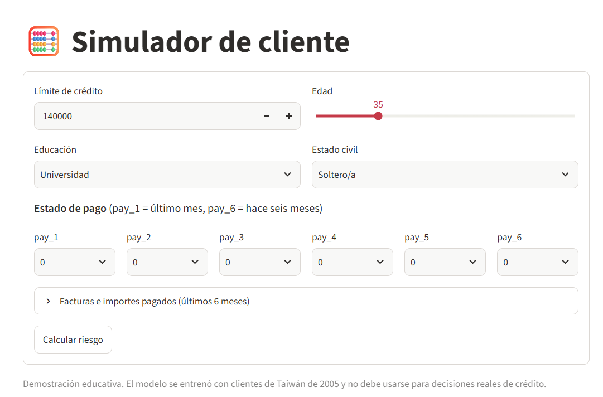

# 💳 Credit Card Default Risk

Predicción de impago de clientes de tarjeta de crédito: limpieza y auditoría de datos, análisis exploratorio, modelos de machine learning, elección del umbral de decisión según el coste, auditoría de equidad y una app interactiva en Streamlit.

**🔗 App desplegada:** https://credit-card-default-risk-faathmnelyoxkmebzrgzgf.streamlit.app/



## Resultados principales

| Modelo | ROC-AUC (prueba) | ROC-AUC (validación cruzada) | PR-AUC |
|---|---|---|---|
| Regresión logística | 0,760 | 0,771 | 0,527 |
| Gradient Boosting | **0,781** | **0,786** | **0,558** |

La tasa de impago del dataset es del 22,1 %. Con el umbral por defecto (0,50) el modelo detecta solo el 37 % de los impagos, así que el umbral se eligió minimizando el coste. En el conjunto de prueba (6.000 clientes, 1.327 impagos):

| Escenario | Impagos no detectados | Buenos clientes señalados | Coste total | Recall | Precisión |
|---|---|---|---|---|---|
| Aprobar a todos | 1.327 | 0 | 6.635 | 0 % | – |
| Umbral 0,50 | 840 | 247 | 4.447 | 36,7 % | 66,4 % |
| **Umbral óptimo (0,16)** | **314** | 1.736 | **3.306** | **76,3 %** | 36,9 % |

El umbral óptimo reduce el coste un 50 % frente a aprobar a todos y un 26 % frente al umbral 0,50.

> **Suposición clave:** un impago no detectado cuesta 5 veces más que señalar por error a un buen cliente (relación 5 a 1). Es una hipótesis, no un dato. Con esa relación, el umbral teórico es 1/(1+5) ≈ 0,17, y el empírico (0,16) coincide, lo que indica un modelo razonablemente calibrado. La app permite cambiar la relación y el umbral.

## Datos y limpieza

Dataset: Yeh, I. (2009). *Default of Credit Card Clients*. UCI Machine Learning Repository. https://doi.org/10.24432/C55S3H (30.000 clientes de Taiwán, 2005, 23 variables).

Decisiones de limpieza (registradas en `reports/findings/data_audit.csv`):

- `PAY_0` se renombra a `PAY_1` y la variable objetivo a `default`.
- `EDUCATION` con valores sin documentar (0, 5, 6): 345 filas agrupadas en "otros".
- `MARRIAGE` con valor sin documentar (0): 54 filas agrupadas en "otros".
- `PAY_*` con -2 y 0 (sin documentar, más de la mitad de las filas): se conservan sin modificar y se tratan como categorías.
- 35 filas duplicadas (sin contar el `id`): se conservan.

## Modelado

- División entrenamiento/prueba (80/20, estratificada) **antes** de ajustar ningún modelo ni umbral.
- Variables derivadas: utilización del límite, ratio de pago, meses con retraso, retraso máximo y tendencia de la deuda.
- **La variable `sex` no se usa en el modelo**, para poder auditar después el trato entre sexos.
- El umbral se elige con predicciones de validación cruzada sobre entrenamiento; el conjunto de prueba solo se usa para el informe final.
- Importancia de variables por permutación: `pay_1` y `months_late` encabezan la lista, prácticamente empatadas porque contienen información muy parecida.

## Equidad

| Grupo | Impago real | Señalados | Recall | Falsos positivos |
|---|---|---|---|---|
| Hombre | 23,4 % | 47,9 % | 78,3 % | 38,6 % |
| Mujer | 21,3 % | 44,4 % | 74,9 % | 36,2 % |

- **Sexo:** sin usar la variable, las diferencias son pequeñas y proporcionales a la tasa real de impago.
- **Edad:** la tasa de falsos positivos sube del 33,6 % (30-39 años) al 43,7 % (50+). La edad sí es una variable del modelo. Es un punto a vigilar; este análisis no incluye intervalos de confianza.
- Excluir una variable sensible no garantiza ausencia de sesgo, porque otras variables pueden actuar como sustitutas.

## Limitaciones

- Datos de Taiwán de 2005: no representan el crédito actual en otros mercados.
- Una sola partición de prueba; no se han calculado intervalos de confianza.
- La relación de costes 5 a 1 es supuesta, y el coste de un falso positivo está simplificado.
- Variables muy correlacionadas se reparten la importancia, y la importancia no implica causalidad.
- Proyecto educativo: no debe usarse para decisiones reales de crédito.

## Estructura del proyecto

```
app/                 App de Streamlit (portada + 3 páginas)
src/credit_default/  Pipeline: limpieza, EDA, variables, entrenamiento, umbral, equidad, explicabilidad
data/processed/      Dataset limpio que usa la app
models/              Modelo entrenado y umbral
reports/findings/    Tablas de resultados que lee la app
reports/figures/     Gráficos
```

## Cómo reproducirlo

1. Clona el repositorio y crea un entorno con Python 3.12:
   ```bash
   pip install -r requirements-dev.txt
   ```
2. Descarga el dataset desde https://doi.org/10.24432/C55S3H, extrae el `.zip` y guarda el archivo como `data/raw/default_of_credit_card_clients.xls`.
3. Ejecuta el pipeline desde la raíz (`PYTHONPATH=src` en Linux/Mac, `$env:PYTHONPATH = "src"` en PowerShell):
   ```bash
   python -m credit_default.data_preparation
   python -m credit_default.eda
   python -m credit_default.train
   python -m credit_default.threshold
   python -m credit_default.fairness
   python -m credit_default.explain
   ```
4. Lanza la app:
   ```bash
   streamlit run app/streamlit_app.py
   ```

El modelo guardado depende de la versión de scikit-learn (1.9.1), fijada en `requirements.txt`. 

Próximos pasos sugeridos: 

1. GitHub Action que ejecute `pytest` en cada `push` (con la insignia de "passing").
2. Hacer que Streamlit consuma la API en lugar de cargar el modelo directamente, que es la arquitectura habitual en producción. 
3. Añadir contenedores de docker para empaquetar la API